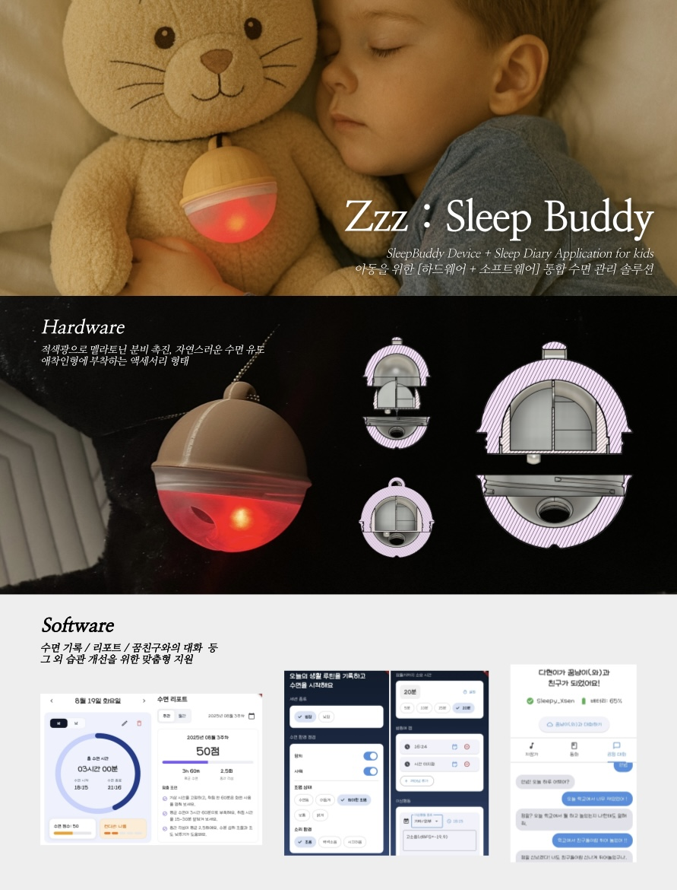
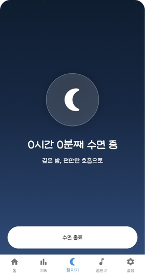
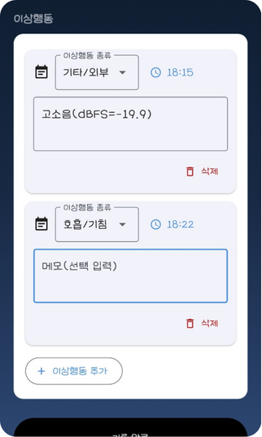
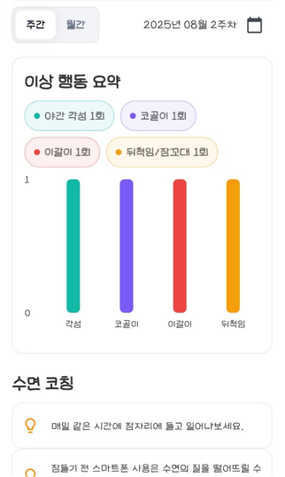
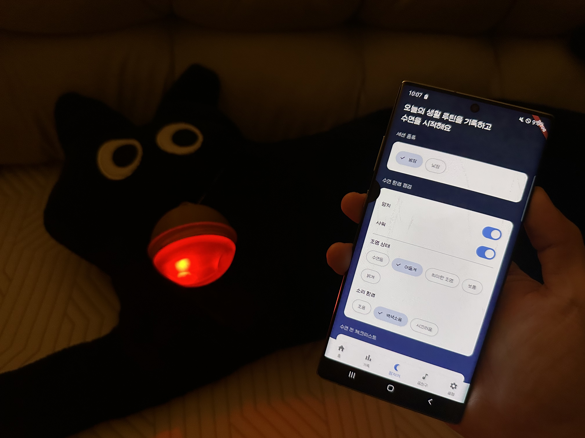
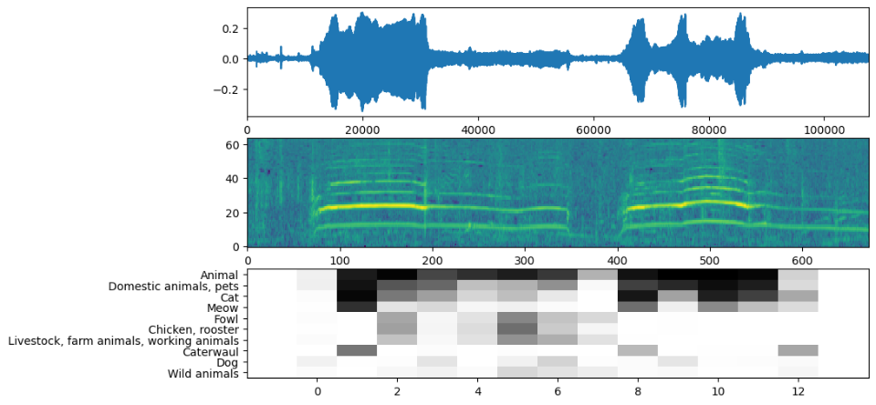

# Zzz : Sleep Buddy

애착 인형에 다는 꿈친구 **Sleep Buddy**와 보호자용 수면 다이어리 앱 **Zzz**로 이루어진 
아동을 위한 **통합 수면 관리 솔루션**

 

2025학년도 제14회 서울대학교 공과대학 창의설계축전 출품작 · Zzz Lab

 

## Hardware

애착 인형에 액세서리처럼 다는 방울 모양의 소형 모듈입니다.

- **적색광 광자극**: 중심 파장 약 630–660 nm 적색 LED를 사용합니다. 멜라토닌 분비 억제는 최소화하면서 생체 리듬을 조절하고, 잠에서 깬 직후의 멍한 상태(수면 관성)를 덜어줍니다.
- **아이에게 친숙한 디자인**: 어느 인형에도 달 수 있는 액세사리 형태의 제품입니다. 아이가 다치지 않도록 부드러운 소재를 사용했습니다.
- **ESP32-C3 기반 CodeCell**: BLE 통신, LED 구동, 3축 가속도 센서(뒤척임·중간 각성 감지), 배터리 상태 전송을 한 보드에서 처리합니다.

## Software

<table>
  <tr>
    <td align="center" width="25%"> <b>수면 중 기록</b> 수면 세션 진행 · 주변 소리 실시간 분석</td>
    <td align="center" width="25%"> <b>수면 후 기록</b> 자동 감지된 이상행동 검토 · 수정</td>
    <td align="center" width="25%"> <b>리포트</b> 이상행동 요약 · 수면 점수 · 코칭</td>
    <td align="center" width="25%"> <b>실사용</b> 기기 적색광</td>
  </tr>
</table>

| 기능 | 설명 |
|---|---|
| **수면 다이어리** | 보호자가 아이의 수면 전·중·후 상태를 간편하게 기록합니다. |
| **AI 소리 분석** | 수면 중 발생하는 코골이, 기침, 호흡 이상 징후, 뒤척임 소리 및 주변 소음을 자동으로 감지하고 분석합니다. |
| **뒤척임 감지** | 기기에서 수집한 가속도 데이터를 실시간으로 분석하여 아이의 뒤척임을 감지하고 기록합니다. |
| **개인 맞춤 생체시계 추정** | 수면 다이어리와 머신러닝을 기반으로 아이별 DLMO(멜라토닌 분비 시작 시각)를 추정하고, 최적의 광자극 시점을 계산합니다. |
| **수면 리포트** | 수면 점수와 타임라인, 이상행동 통계, 목표 수면 일정 대비 루틴 이행률을 시각화하고 개인 맞춤형 수면 코칭을 제공합니다. |
| **꿈친구 대화** | 아이가 좋아하는 캐릭터의 말투와 목소리를 구현하여 인형과 직접 대화하는 듯한 상호작용 경험을 제공합니다. |
| **자장가·동화** | 인형이 직접 자장가를 불러주고 동화를 읽어주는 듯한 경험을 제공하여 아이의 편안한 잠자리를 돕습니다. |

 

## 기술 상세

### ① 적색광 광자극

적색광(630–660 nm)은 생체시계 조절과 수면 관성 완화에 도움을 줄 수 있습니다.

- **수면 중**: 아이별로 추정한 DLMO 시점에 맞춰 2 ms의 짧은 섬광을 30초 간격으로 60분간 조사하여 생체시계 조절을 유도합니다.
- **기상 전**: 목표 기상 시각 1시간 전부터 은은한 적색광을 지속적으로 조사하여 수면 관성을 완화하고 보다 자연스럽고 개운한 기상을 돕습니다.

### ② YAMNet 소리 분류

 출처: <a href="https://www.tensorflow.org/hub/tutorials/yamnet">TensorFlow · YAMNet</a>

- 수면 중 주변 소리를 16 kHz로 녹음하고, 기기 안(TFLite)에서 바로 분류합니다.
- 사전학습된 YAMNet을 수면 중 소리에 맞게 파인튜닝**해 **코골이 · 호흡/기침 · 뒤척임 · 외부 소음을 구분합니다.

### ③ Kalman Smoother 기반 DLMO 추정

Zzz는 별도의 생체 신호 측정 없이 수면 일지만으로 DLMO(멜라토닌 분비 시작 시각)를 추정합니다.

이를 위해 DLMO의 일별 변화를 상태공간모형(State-Space Model)으로 표현합니다.

$$
\begin{aligned}
x_d &= x_{d-1} + \varepsilon_d, &\varepsilon_d &\sim \mathcal{N}(0, Q) \\
SO_d &= x_d + L + \eta_d, &\eta_d &\sim \mathcal{N}(0, R)
\end{aligned}
$$

여기서 $x_d$는 $d$일차 DLMO, $SO_d$는 입면 시각, $L$은 DLMO와 입면 시각 사이의 개인별 위상각을 의미합니다.

- **DLMO 추정:** Kalman Filter와 RTS Smoother를 활용하여 일별 DLMO를 추정하고, EM 알고리즘으로 노이즈 파라미터를 추정하며 개인별 위상각 $L$을 갱신합니다.
- **자동 업데이트:** 수면 기록이 7일 이상 누적되면 추정을 시작하며, 이후 새로운 기록이 저장될 때마다 최근 30일간의 데이터를 기반으로 DLMO를 자동 재추정합니다.

 

## 👥 Team

| 강다현 | 박세은 |
|:---:|:---:|
| 서울대학교 기계공학부 | 서울대학교 공예과 |

2025 서울대학교 공과대학 창의설계축전 · 다학제 부문 · 제작 기간 2025.06.30 – 2025.08.31

Contributed by @dahyunk-snu and @ppaxen

 